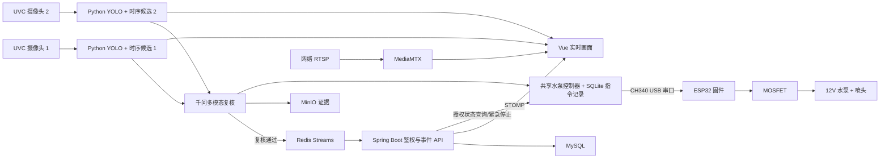

# 系统架构概览

当前基础功能为双 UVC 独立识别、大模型复核和 ESP32 自动喷水。保留账号和教室管理，删除人工审核与事件手动状态流转。

## 关键边界

- 两路本机摄像头各自拥有运行状态、帧缓冲、推理管线和复核队列。图中的大模型为同一云服务，各路独立调用，不做跨视角融合。
- UVC 视频由 Python 直接采集并通过 MJPEG 预览；网络视频预览仍使用 MediaMTX。事件走 Redis/WebSocket。
- Python 不写 MySQL；Spring 管理账号、教室、绑定、只读事件历史和证据读取。浏览器不接收控制令牌或云端密钥。
- 共享泵只覆盖指定教室；每次启动要求新鲜正向大模型结果，发送前持久化唯一指令并二次检查时效/停止标记。串口断连或回执丢失不会自动重试 RUN。
- 停止指令可重复发送。ESP32 负责 GPIO 上电关闭、运行截止时间和心跳超时关闭；控制器回执无法证明实际出水。
- 模拟 JSONL 回放不构造硬件控制器。界面模拟模式也不发送真实泵控制。
- Redis 消费失败保留 pending 记录，数据库提交后才向前端广播。

接线、启动与实机验收见 [双 UVC + ESP32 自动喷水](../runbooks/esp32-pump.md)。
