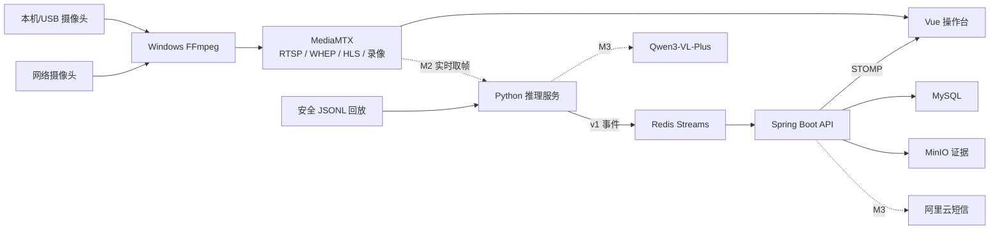

# 系统架构概览

## 关键边界

- 视频数据走 MediaMTX，告警事件走 Redis/WebSocket，避免把高带宽视频塞入业务消息；
- Python 只发布版本化事件，不直接修改业务数据库；
- Spring 负责鉴权、幂等、状态流转、通知和审计；
- 浏览器只接收短期播放地址，不接收 RTSP 密码、短信密钥或百炼密钥；
- Redis 消费失败保留 pending 记录，数据库提交后才向前端广播。
