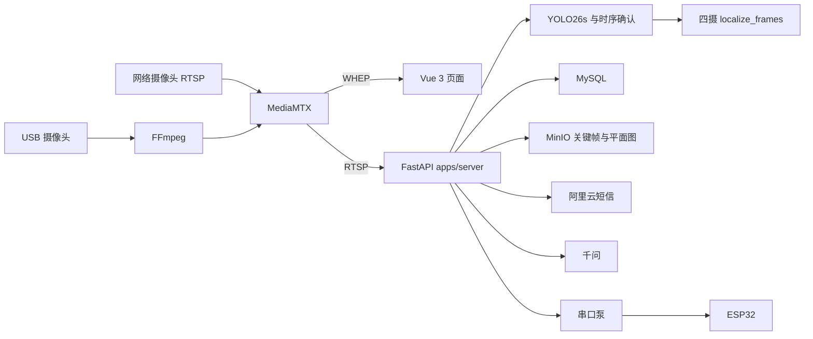

# 系统架构概览

当前程序是一个 FastAPI 后端、一个 Vue 3 页面，以及被后端调用的 Python 推理包。启动和配置见 [README](../../README.md)。

画面只走 MediaMTX。检测不直接打开摄像头。告警、账号、教室和标定写在 MySQL。没有 Redis，也没有单独的 Java 进程。

教室最多绑定 4 路。定位需要每路内参、畸变和至少 4 个米制控制点。泵的串口参数在 `config.json`。接线和固件见 [ESP32 水泵](../runbooks/esp32-pump.md)。
