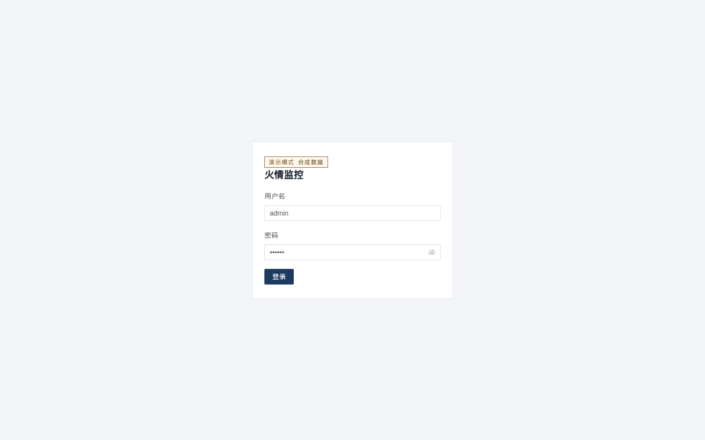
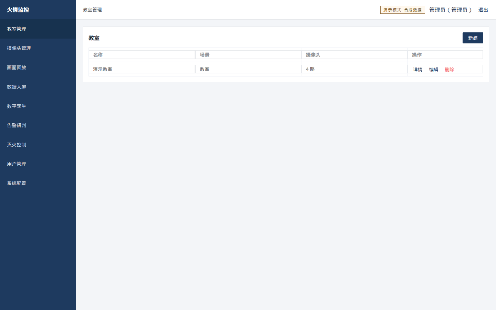
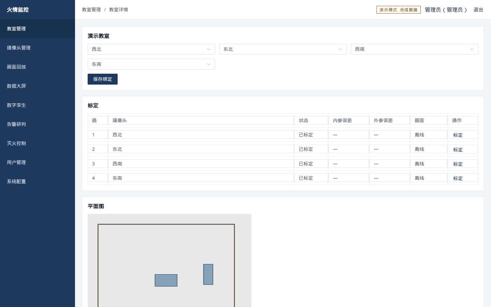
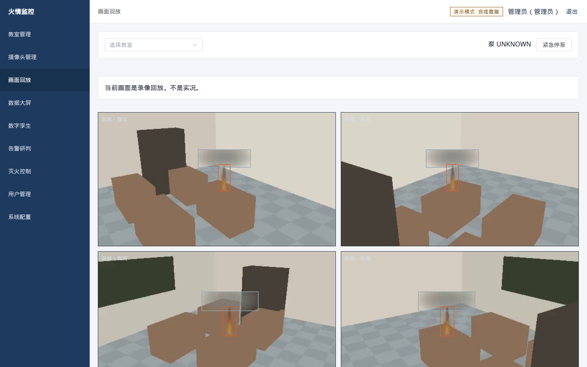
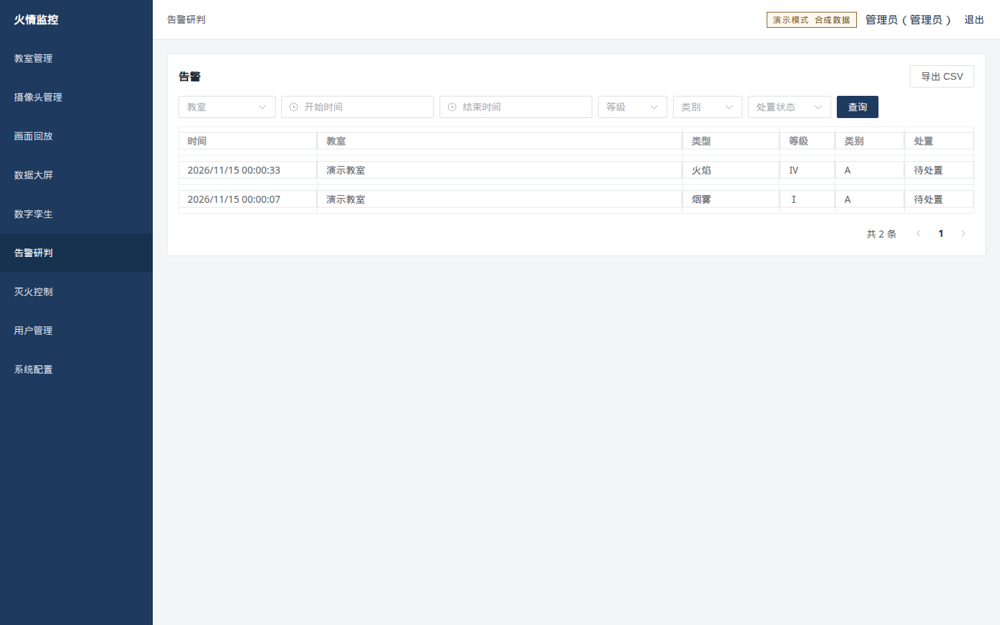
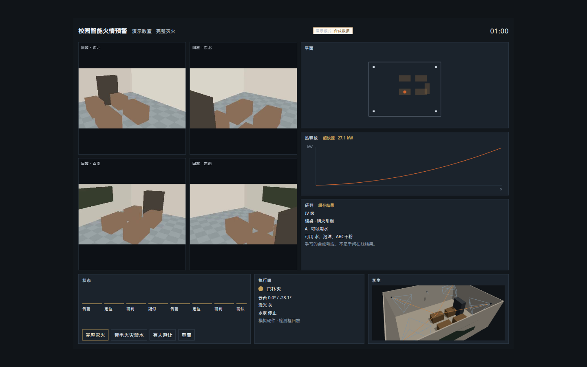
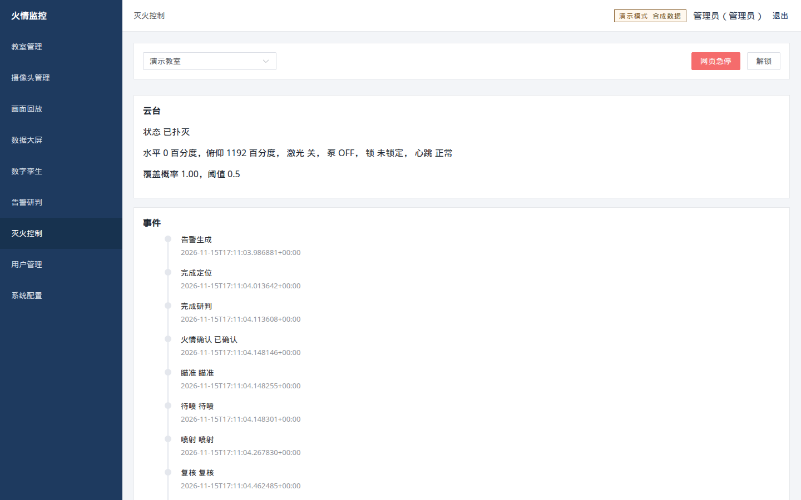

# 校园智能火情预警与辅助决策系统 V2.0

## 软件说明书

本说明书供软件著作权登记使用，按操作手册编写。软件在仓库和界面中的名称是「火情监控」。登记名称拟用「校园智能火情预警与辅助决策系统 V2.0」。包描述文件中的版本号仍是 1.0.0，与拟登记的 V2.0 不是同一个字段。

说明书中的截图来自演示模式。演示数据是程序生成的教室、火焰和手写研判，不是现场录像，也不是检测模型的在线输出。页面上有「演示模式」标记。

## 1. 功能

系统用于校园房间的火情监视和辅助处置，已实现的功能如下：

- 管理员维护教室、最多四路摄像头、标定和平面图。
- 实况画面经 MediaMTX 用 WebRTC 播放。检测读取该路 RTSP，不直接占用摄像头。
- 火焰和烟雾按类别做时序确认。至少两路已标定且窗口内有观测时计算三维位置。
- 告警保存关键帧和短视频。值班员可以确认、标记误报、结案。大模型启用时可以重新研判。
- 研判结果和规则表给出火灾类别，以及是否禁止用水。程序不由大模型直接选择灭火剂。
- 灭火状态机在联锁通过后向执行节点发送瞄准和喷水。附近有人、禁水、未定位、急停等情况不喷。
- 报警节点显示监视、疑似、确认和急停等灯光模式。
- 演示模式用合成四路画面跑同一套状态机，不连接摄像头和 ESP32。

尚未作为结果写入本说明书的事项：教室现场定位误差、四路实况延迟、水泵实际出水。这些都还没有做。

## 2. 运行环境

- 操作系统：64 位 Windows 10 或 Windows 11。持续集成在 Ubuntu 上运行测试，不作为交付安装步骤。
- 运行依赖：Python 3.11 至 3.13、MySQL 8.4、MinIO、MediaMTX、FFmpeg。前端构建使用 Node.js；已有静态构建时，后端可以直接提供页面。
- 可选硬件：USB 或 RTSP 摄像头最多四路，ESP32 执行节点和报警节点各一块。
- 浏览器：使用系统浏览器访问 `http://127.0.0.1:8080`。
- 编程语言：Python、TypeScript、C++。

模型权重不随源代码提供。没有权重文件时不能做实况检测，演示模式不需要它。

## 3. 安装和启动

在仓库根目录执行 `scripts\windows\install-and-start.bat`。脚本安装 Python、Node、FFmpeg 和 MediaMTX，创建虚拟环境，安装依赖，构建前端，并在缺少 `config.json` 时从示例复制。脚本不填写密钥。数据库密码、对象存储密钥和登录签名密钥由操作者自己修改。示例中的占位口令只与本机 Docker 默认值一致。

然后脚本启动 MySQL、MinIO、后端和 MediaMTX，并打开浏览器。数据库里还没有摄像头时，监控页没有实况。管理员添加摄像头后，再运行 `scripts\windows\start-streams.ps1`。

没有摄像头和 ESP32 时，执行 `scripts\windows\start-demo.bat`。演示副本关闭串口，不启动 MediaMTX。

初始示例账号是管理员 `admin` 和值班员 `duty`，口令都是 `123456`。正式使用前应修改。本文不列出其他密钥。

## 4. 登录

打开地址后输入用户名和密码。演示模式在登录卡片上显示标记。

管理员看到教室、摄像头、监控、告警、灭火控制、用户和系统配置。演示模式另有数据大屏和数字孪生。值班员没有用户管理和系统配置，也不能开始演示剧本、解锁急停或手动喷水。

## 5. 教室和标定

管理员新建教室并选择场景，再登记摄像头，在教室详情中绑定到四个槽位以内。

标定分内参和外参。内参使用打印的 ChArUco 板，抓取多张画面后计算。外参在画面中检测控制点，并填写每个点在教室坐标系中的米制坐标，至少四个点。只有内参时不能参加定位。平面图需要原点像素、原点的世界坐标和每像素对应的米数。可燃物区域在同一页绘制。

## 6. 监视和告警

选择教室后看到四路画面。实况来自 WebRTC。演示模式改为回放合成图像，并在页内写明不是实况。

确认告警后，研判页显示关键帧、位置、类别和处置记录。值班员可以把待处置标为确认或误报，把已确认标为结案。监控页的紧急停泵对两种角色都可用。

## 7. 演示剧本

管理员在数据大屏选择「完整灭火」「带电火灾禁水」或「有人避让」。第一种在联锁通过后进入喷射和扑灭。第二种因规则禁水而不喷。第三种因火点附近有人而不喷。大屏标明研判来自缓存的合成响应。

## 8. 灭火和急停

灭火控制页显示阶段、云台、激光、泵、锁和心跳。自动喷水前检查本地火焰、禁水规则、定位、覆盖概率、人员距离、心跳、证据时间和冷却。不满足时不发送喷水命令。

网页急停或执行节点上的急停都会进入锁定并停止输出。松开急停、按下复位键之后，由管理员在页面解锁，系统才回到监视。值班员可以急停，不能解锁。

## 9. 停止

执行 `scripts\windows\stop.ps1` 结束脚本启动的进程，再执行 `docker compose stop` 停止数据库和对象存储。配置文件留在本机，不要提交。
