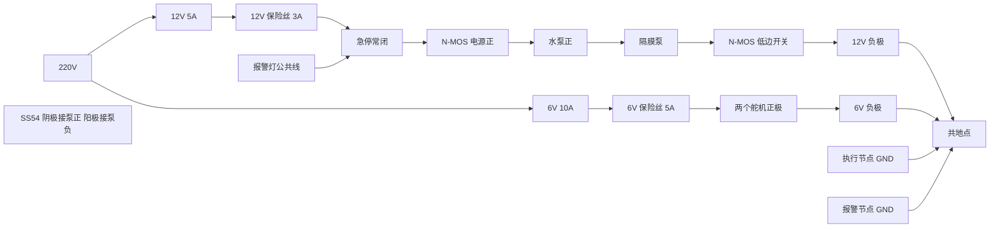

# 两块 ESP32 的接线

两块都是 ESP32-D0WDQ6 DevKitC，插在 30Pin 扩展板上，各自用 USB 线连接 Windows 主机。执行节点烧录 `firmware/esp32_actuator`，报警节点烧录 `firmware/esp32_panel`。

不要用 GPIO 0、2、5、12、15（启动绑带脚），不要用 GPIO 6–11（Flash），不要用 GPIO 34、35、36、39（只能输入，没有内部上拉）。下面的脚都避开了这些。

高电平让 MOS 模块导通。水泵、舵机、激光、报警灯的负极最后都要和两块 ESP32 的 GND 接在同一颗接线端子上。12V 正极和 6V 正极不能接在一起。

## 执行节点引脚

| GPIO | 方向 | 接到 |
|---|---|---|
| 26 | 输出 | NCE4080K 模块的信号 IO。板上两个 IO 是同一信号，接其中一个 |
| 25 | 输出，50 Hz PWM | 水平舵机 TBS-K20 信号线（通常是橙或黄） |
| 27 | 输出，50 Hz PWM | 俯仰舵机 TBS-K20 信号线 |
| 33 | 输出 | KY-008 的 S |
| 32 | 输入，内部上拉 | 急停常开触点的一端，另一端接 GND。按下为低 |
| 4 | 输入，内部上拉 | 复位按钮的一端，另一端接 GND。按下为低 |
| GND | | NCE4080K 的两个 GND、两个舵机的棕线、激光 GND、急停和复位的公共端 |
| 5V / VIN | | KY-008 的 VCC。模块按 5V 供电，不要接到 3.3V |

水平软件限位 ±120°，俯仰 0° 到 60°，最快 90°/s。0° 对应舵机脉宽 1500 µs。

## 报警节点引脚

| GPIO | 方向 | 接到 |
|---|---|---|
| 16 | 输出 | 4 路 MOS 模块第 1 路，红灯 |
| 17 | 输出 | 第 2 路，黄灯 |
| 18 | 输出 | 第 3 路，绿灯 |
| 19 | 输出 | 第 4 路，蜂鸣器 |
| 21 | I²C SDA | SSD1306 SDA |
| 22 | I²C SCL | SSD1306 SCL |
| 23 | 输入，内部上拉 | 静音按钮的一端，另一端接 GND |
| GND | | MOS 模块 GND、屏幕 GND、静音按钮公共端 |
| 3.3V | | SSD1306 VCC |
| 5V / VIN | | 只在屏幕模块标明要 5V 时才用，和 3.3V 二选一 |

屏幕按 0.96 寸 SSD1306、I²C 地址 0x3C 写。驱动只在 `firmware/esp32_panel/src/display_ssd1306.cpp`。换屏时替换这个文件，不要改协议。

报警灯公共线接 +12V。红、黄、绿、蜂鸣四根信号线分别进 MOS 模块的四路负载高端，模块低端回 12V 负极。高电平导通，灯被拉向地。

## 电源

12V 5A 只供水泵和报警灯。6V 10A 只供两个舵机。ESP32 由 USB 供电。

急停是 LAY39B-11ZS，只有一副常闭和一副常开。一副常闭触点不能同时串进 12V 正极和 6V 正极，否则两路电源会在触点处并在一起。常闭触点只串在 12V 水泵供电正极上，按下后水泵失去 12V。6V 舵机电源不经过这副触点；急停按下后固件停止舵机脉宽。要在硬件上同时切断 6V，需要再补一副常闭触点，不能把 6V 正极并进现在这一副。

报警灯的 12V 取急停常闭之后，急停按下时灯也会灭。灯的四路仍由报警节点的 MOS 模块做低边开关。

SS54 并在泵的两端：阴极（有环的一端）接泵正，阳极接泵负。泵不转时二极管不导通。也可以用 1N5819，方向相同。

NCE4080K 模块的两个 GND 都接到共地点。信号 IO 接 GPIO26。

## 第一次上电

泵先不接水，电机线也先不要接到 MOS 模块的负载端。

1. 急停按下。万用表直流电压档：12V 电源输出应有约 12V；急停常闭的下游（MOS 模块电源正）应为 0V。
2. 急停松开。下游应为约 12V。再按下，下游回到 0V。
3. 电阻档，断电测量：12V 正极和 6V 正极之间必须不通。12V 正极和 GND 之间不能是短路，6V 正极和 GND 之间也不能是短路。
4. 舵机信号线对 6V 正极、对 GND 都不是短路。激光 S 对 5V、对 GND 都不是短路。
5. 两块板只插 USB，不接 12V 和 6V。烧录对应固件。串口 115200，执行节点发 `HELLO` 应回 `READY FIRE_ACTUATOR_V2`，`STATUS` 里泵和激光都是 `OFF`。报警节点发 `HELLO` 应回 `READY FIRE_PANEL_V2`。
6. 断电后再接上 12V 和 6V，泵的电机线仍不接。执行节点 `LASER ON` 只应点亮激光，GPIO26 仍为低。用电压档确认 MOS 模块负载端没有 12V 输出。
7. 确认负载端为 0V 之后，再接上泵的电机线，仍然不加水。`RUN` 用协议测试里的短时长点动一次，看电机转向和有没有异常发热，然后 `STOP` 或等它自己停。空转只做这一次。
8. 急停按下时再测：泵两端电压为 0，并且再发 `RUN` 得到 `ERR ESTOP`。松开急停、按一下复位、主机发 `UNLOCK` 后才回到 `UNLOCKED`。

220V 只接在成品电源的输入插头上，低压调试时不打开电源外壳。水以后只喷向接水盘，不对着带电设备。
