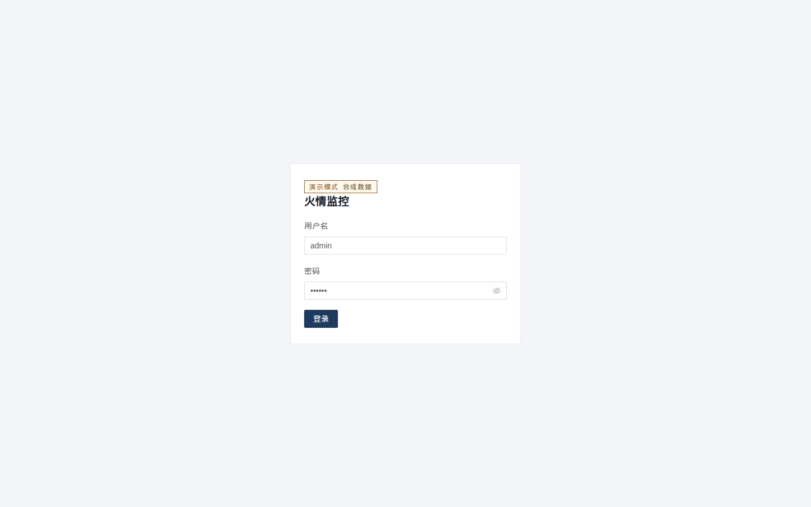
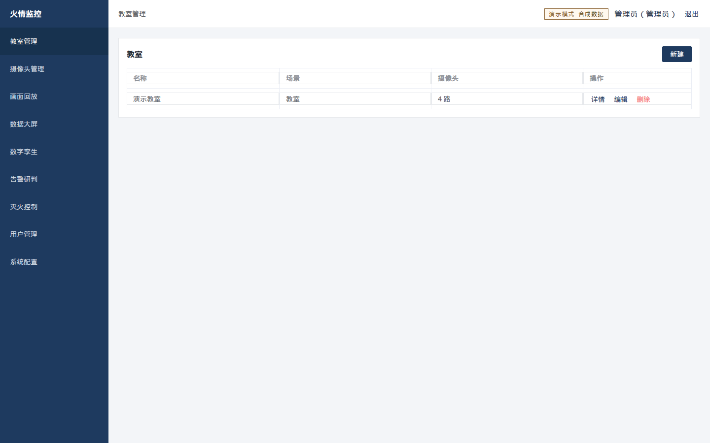
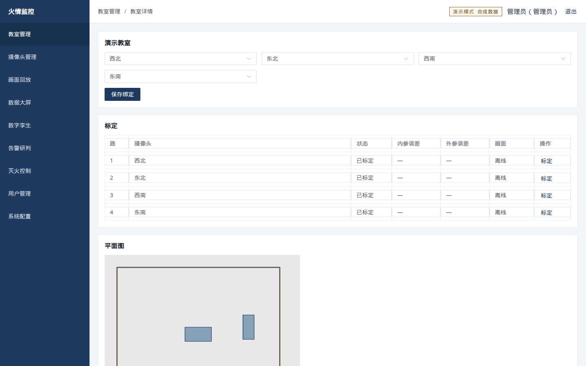
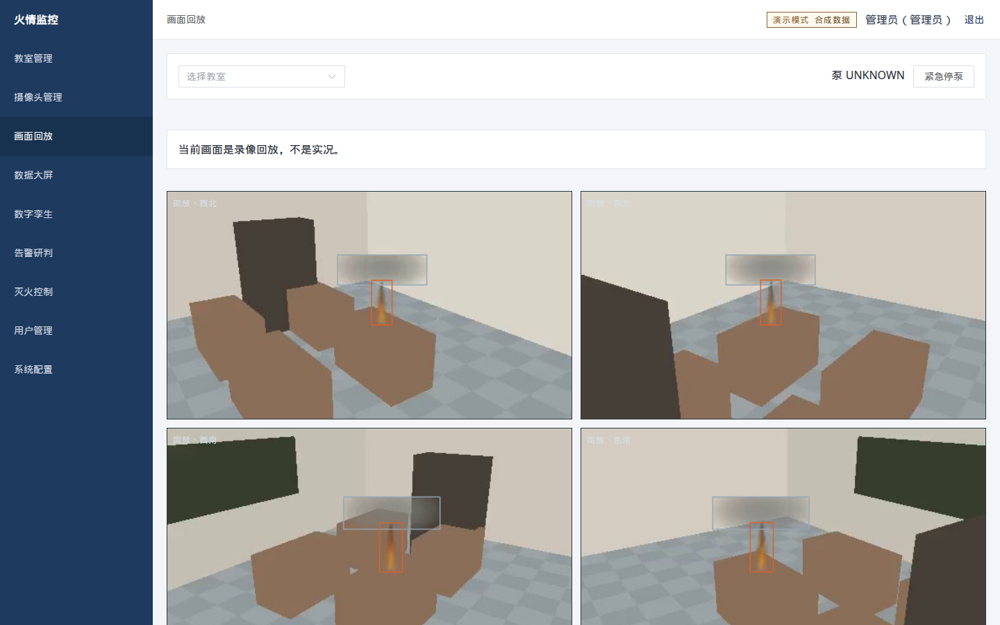
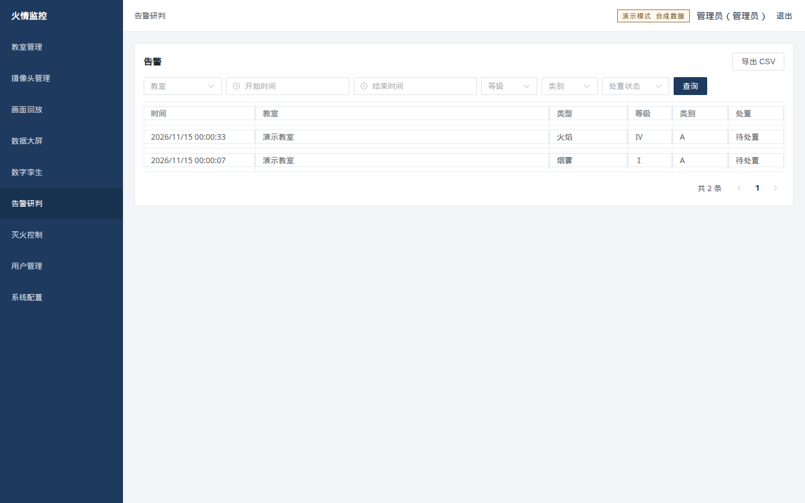
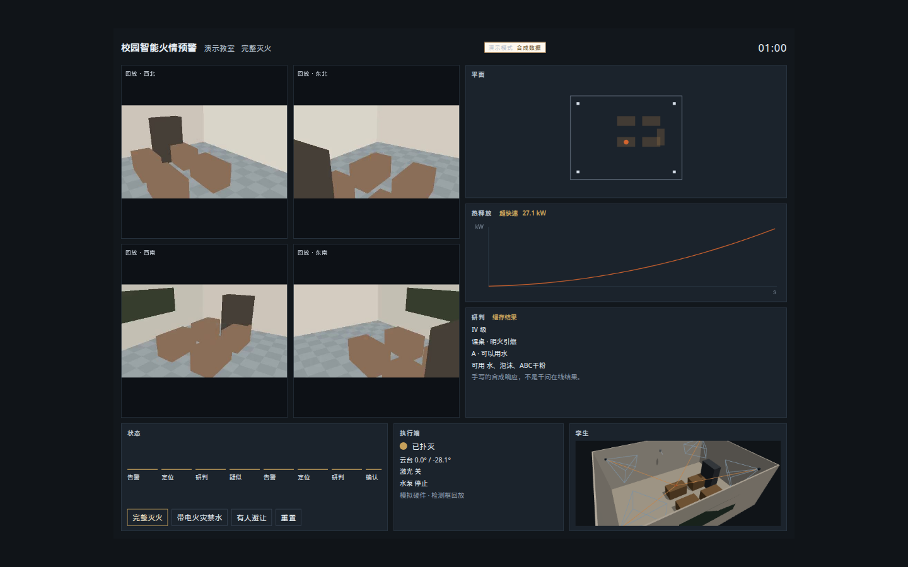
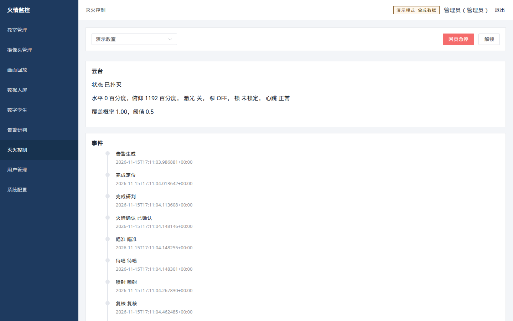

# 用户手册

本文说明火情监控的管理员和值班员怎么使用现有页面。界面名称是「火情监控」。申报名称拟用「校园智能火情预警与辅助决策系统 V2.0」。

账号由 `config.json` 的初始用户或管理员在用户管理中创建。角色只有两种：管理员（`admin`）和值班员（`operator`）。

下面的截图来自演示模式。画面是 `data/demo/synthetic-classroom` 的合成数据，页面上有「演示模式」标记。不要把这些图当成现场录像或模型检测结果。

## 1. 登录和菜单

打开部署手册中的地址，输入用户名和密码。



登录后的菜单：

| 菜单 | 管理员 | 值班员 |
|---|---|---|
| 教室管理、教室详情 | 可新建、修改、删除、绑定摄像头、标定、平面图 | 可查看 |
| 摄像头管理 | 可新建、修改、删除、保存标定 | 可查看 |
| 实时监控或画面回放 | 可查看，可紧急停泵 | 同左 |
| 数据大屏、数字孪生 | 仅演示模式。开始和重置剧本仅管理员 | 可查看 |
| 告警研判 | 可确认、标记误报、结案、重新研判、导出 | 同左 |
| 灭火控制 | 可急停、解锁、瞄准、喷水、激光标定和弹道拟合 | 可查看和急停，不能解锁或手动喷水 |
| 用户管理、系统配置 | 可用 | 没有这两个菜单 |

任意已登录页面都会连接 WebSocket。出现新的确认告警时弹出通知并播放短促提示音。

## 2. 管理员：教室、摄像头和标定

教室管理用于建立房间并选择场景。场景包括教室、实验室、配电间、宿舍、食堂后厨、仓库和走廊。



摄像头管理登记每一路的名称、来源和帧率。USB 使用 DirectShow 设备名，网络摄像头使用 RTSP 地址。来源修改后，要重新运行 `scripts\windows\start-streams.ps1`，MediaMTX 和 FFmpeg 才会按新配置推流。

教室详情把最多 4 路摄像头绑到槽位。未标定的绑定会标出来。标定在同一页完成：

1. 下载 ChArUco 板或控制点板，纸张为 A4 或 A3。打印后按板子的实际尺寸使用，不要在页面上把比例改掉凑数。
2. 内参：抓取多张包含标定板的画面，再执行标定。结果写入该摄像头的内参和畸变，畸变顺序是 OpenCV 的 `k1, k2, p1, p2, k3`。
3. 外参：抓取一张能看见控制点的画面，检测标记，为每个点填写教室坐标系中的 X、Y、Z，单位是米。至少 4 个点才能作为已标定。世界坐标原点由现场的标定物决定，程序不假定教室的某个角。
4. 只有内参、控制点不足 4 个时，状态是「仅内参」，不能参加定位。



平面图上传一张图片，并填写原点在图上的像素、原点的世界坐标，以及每像素对应多少米。图上 X 向右、Y 向上，像素 u 向右、v 向下。火点按下面两式绘制：

```text
u = origin_px[0] + (X - origin_world_x) / meters_per_pixel
v = origin_px[1] - (Y - origin_world_y) / meters_per_pixel
```

同一页可以标出可燃物区域。这些区域供蔓延判断使用，不会代替灭火器或现场处置。

摄像头页和监控页会显示离线、画面冻结和模糊。冻结和离线的秒数在 `health` 配置中。模糊使用标定里的拉普拉斯方差阈值。

## 3. 值班员：监控和告警

实况监控选择教室后显示四宫格。检测框叠在画面上，火和烟用不同颜色。每路还显示时序状态和画面健康。

演示模式下，这一页改称「画面回放」，并写明不是实况。四路图像来自合成包，不经过 MediaMTX。



监控页的「紧急停泵」对已登录用户开放。它向执行节点发送停止，不等待管理员。

告警研判列出本教室或全部告警。打开一条告警可以看到关键帧、视频片段、定位、研判和处置记录。

处置动作：

- 待处置可以「确认」或「标记误报」。
- 已确认可以「结案」。
- 结案时可以填写说明。
- 「重新研判」要求大模型已经启用。未启用时接口返回「大模型未启用」。
- 列表可以导出 CSV 或 PDF。



定位至少需要两路同时具备标定和窗口内观测，最多四路。结果为 `ESTIMATED` 时写入坐标、协方差、条件数和支持摄像头，平面图标出火点。不足两路或几何上不可观测时为 `UNOBSERVABLE`：告警仍然生成，平面图不标点。

火的观测取框底边中点，烟取框中心。低于配置阈值的框不进入时序，也不作为定位观测。当前示例阈值是火焰 0.30、烟雾 0.35。

## 4. 演示模式

演示模式不需要摄像头和 ESP32。启动方式见《部署手册》。

管理员打开「数据大屏」，选择一个剧本：

- 完整灭火：合成火点，规则允许用水，状态机走到喷射和扑灭。
- 带电火灾禁水：研判为 E 类，不喷水。
- 有人避让：火点附近有人，不喷水。

三个剧本的千问结果都是包内的手写缓存，页面会标明缓存和合成响应。检测框来自投影几何，不是 YOLO 的输出。



播放速度和待喷、喷射时长必须与生成录像时一致：待喷 3 秒、喷射 5 秒、复核清除 3 秒。配置被改过时，播放会拒绝启动并说明原因。

值班员可以看大屏和数字孪生，不能开始或重置剧本。

## 5. 灭火联锁

灭火控制页显示当前阶段、云台角度、激光、泵、锁存、心跳和覆盖概率。阶段按顺序包括：监视、疑似、已确认、瞄准、待喷、喷射、复核、已扑灭。受阻时停留在已确认。两次修正后仍未扑灭则进入「需人工处置」。急停进入「锁定」。



自动喷水要同时满足这些条件，缺一项就不发 `RUN`：

- 本地时序已经确认火焰。只看到烟时进入疑似，不喷水。
- 规则表没有禁止用水。类别来自 `config/fire_rules.json` 和研判证据。配电间在没有千问结果时也按禁水处理。带电、油脂、部分液体和金属粉末会禁止用水或直流水。
- 若配置要求千问，则研判必须成功，并且看见火或烟。
- 定位状态是 `ESTIMATED`，协方差标准差不超过 `max_std_m`，瞄准解算有结果。
- 覆盖概率低于 `cover_threshold` 时，扫射从估计点出发，后面沿落点平面上协方差的主轴、按喷射半径加点。最多 3 个落点，取并集覆盖概率最大的点数。并集概率仍不低于阈值才喷，否则留在已确认，继续观察。
- 火点与检测到的人的距离不小于 `person_distance_m`。
- 执行节点心跳正常，证据没有过期，冷却时间已过，水泵已启用且覆盖这间教室。
- 摄像头没有被停止。

页面上三种中文原因是「超出喷射范围」「禁止用水」「附近有人，已停止喷水」。其余原因直接显示内部代号，例如 `COVARIANCE`、`HEARTBEAT`。

手动瞄准和手动喷水只有管理员可以操作。手动喷水仍检查定位、人员、心跳和冷却，不能绕过急停和禁水。

激光自标定和弹道拟合也只有管理员可以提交。自标定至少 12 组样本，弹道拟合 3 到 4 次落点。参数写入 `runtime/gimbal.json`。现场步骤、批准和监护要求见 `docs/runbooks/suppression.md`。本系统没有在仓库记录中完成过出水试验。

## 6. 急停

两处可以停：

- 监控页「紧急停泵」。已登录的管理员和值班员都可以按。
- 灭火控制页「网页急停」。同样对已登录用户开放。状态机进入锁定，关闭泵和激光。

执行节点上的急停触点由固件锁存：关泵、关激光、停止舵机。此后 `RUN`、`AIM`、`LASER` 回复 `ERR ESTOP`。只松开急停不够。复位键按下后锁状态变为 `ARMED`，管理员再在页面上「解锁」，主机发送 `UNLOCK`，阶段才回到监视。急停仍按着时解锁会被拒绝。固件还停在 `LATCHED`、复位键尚未按下时，解锁也不会成功。

报警节点在锁定时使用黄红交替。主机 3 秒没有报文时，固件自己也会变成黄红交替，这表示链路中断，和急停不是同一件事。

## 7. 系统配置

管理员可以修改非密钥配置，例如阈值、时序帧数、灭火参数和演示开关。保存后写入 `config.json`，重启后端生效。密钥字段不出现在页面返回值里，保存时保留文件中的原值。

值班员打不开这一页。
