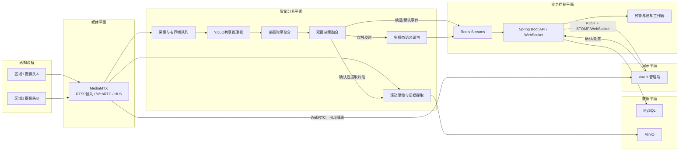

# 智能火灾监控系统前后端详细构建计划

版本：v1.0  
日期：2026-07-16  
适用范围：教室、实验室双视角火焰/烟雾监控研究原型

## 1. 结论与总体方案

本项目不应直接复制参考项目的“Vue 直连 Flask WebSocket，Flask 同时传视频、推理、调用大模型和写记录”结构。推荐采用“媒体平面、智能分析平面、业务控制平面”分离的架构：

- 媒体平面：摄像头 RTSP 接入 MediaMTX，浏览器优先通过 WebRTC 播放，HLS 作为兼容降级；
- 智能分析平面：Python 算法服务独立拉取 RTSP，完成 YOLO、单摄时序融合、双摄决策融合和多模态语义研判；
- 业务控制平面：Spring Boot 统一负责用户、权限、摄像头、监控区域、事件、预警、处置、审计和统计；
- 数据平面：MySQL 保存结构化业务数据，Redis Streams 传递算法事件和控制命令，MinIO 保存截图、事件前后视频和分析附件；
- 展示平面：Vue 3 只连接 Spring Boot 和媒体网关，不接触摄像头真实 RTSP 密码，也不直接调用算法服务或大模型。

最终演示系统部署在用户的 Windows 11 笔记本上：Python/FFmpeg 原生使用 RTX 5060 Laptop 与摄像头，其他服务通过受限资源的 Docker Compose 运行。训练可以在 AutoDL 完成，但 `.pt`/ONNX 下载到本机后必须重新做性能验证；TensorRT engine 在本机生成。第一版不使用 Kubernetes，也不拆成过多业务微服务。

## 2. 对参考项目的审查结论

### 2.1 可参考和复用的部分

参考项目前端已有 Vue 3、TypeScript、Element Plus、Pinia、ECharts、登录、摄像头管理、监控宫格、记录管理和管理控制台等页面骨架。可以复用：

- 页面信息架构、布局样式和基础组件；
- 摄像头列表、1/4/9 宫格、事件缩略图、记录筛选等交互思路；
- Axios API 分层、Pinia 用户状态、Vue Router 权限路由的组织方式；
- MediaMTX 提供模拟 RTSP 流的测试思路；
- “YOLO 初筛后再调用多模态模型”的按需调用原则。

### 2.2 不能直接照搬的部分

经本地检查，预览版约有 34 个 Vue/TypeScript 源文件和 1.1 万行前端代码，但 Spring Boot 和 Flask 源文件数量均为 0；后端和算法端只是购买提示。因此它不是可直接部署的完整系统。

必须重构以下设计：

1. 参考算法示例把 COCO 的人员和车辆类别当作火灾分析输入，没有真正使用 `fire/smoke` 专用检测类别；
2. 前端 WebSocket 直接连接算法端，业务事件绕过 Spring Boot，难以保证权限、持久化、重试和审计；
3. 视频帧与检测 JSON 混在同一 WebSocket 链路，不适合多路高清监控；
4. 前端直接展示 RTSP URL，会暴露摄像头账号和密码；
5. `flv.js` 方案可用于特定 HTTP-FLV 服务，但参考代码没有完整的转码、鉴权和断线恢复链路；
6. 数据库只有用户、摄像头和检测记录三张表，无法表达监控区域、双摄绑定、时序证据、融合结果、事件状态机、通知重试和模型版本；
7. 前端出现 `low/medium/high` 与 `minor/moderate/severe/critical` 两套风险枚举，说明缺少统一接口契约；
8. 文件服务是不可审计的单个可执行文件，不适合作为项目的核心证据存储；
9. 文档中的准确率、误报率和响应时间只是粗略估计，不能作为本项目验收数据。

结论：参考前端可以作为 UI 原型，不应在原目录上继续堆补丁。建议将其复制到本项目新仓库后，按统一数据契约逐页迁移。

## 3. 已确认的演示环境和冻结决策

### 3.1 本机实测环境

已在演示电脑上完成只读检查，当前配置为：

| 项目 | 实测结果 | 对方案的影响 |
|---|---|---|
| 操作系统 | Windows 11 专业版 64 位 | 最终演示按 Windows 单机设计 |
| CPU | AMD Ryzen 9 8940HX，16 核 32 线程 | 足够承担两路 720p CPU 解码/编码 |
| 内存 | 约 15.3GB 可识别内存 | Docker 必须限额，演示时关闭大型 IDE 和无关程序 |
| GPU | RTX 5060 Laptop，8151MiB 显存 | 采用 n/s 模型、FP16、640 输入和最多 batch=2 |
| NVIDIA 驱动 | 580.97 | 满足当前 Blackwell PyTorch CUDA 运行要求 |
| 存储 | C 盘剩余约 70GB；D 盘剩余约 191GB；E 盘剩余约 62GB | 数据库、MinIO、录像和日志统一放 D 盘 |
| 摄像头 | `Integrated Camera` 已被 Windows 正确识别 | 可作为 `VIEW_A` |
| 运行时 | FFmpeg、Docker、Java 17、Node 24 已安装 | 可直接构建 Windows 演示栈 |
| Python | Anaconda Base Python 3.13，未安装 PyTorch | 新建独立 Python 3.11 环境，不污染 Base |

### 3.2 已冻结的产品决策

- 最终推理和演示在此 Windows 笔记本运行，不依赖 AutoDL 在线实例；
- AutoDL 只负责模型训练，模型文件下载到本机后部署；
- 同时接入 1 至 2 路摄像头；
- `VIEW_A` 使用内置前置摄像头；
- `VIEW_B` 第一选择为免驱 UVC USB 摄像头，要求至少支持 720p30，最好支持 1080p30、MJPEG/H.264 和标准三脚架接口；网络摄像头作为后续替代；
- 内置摄像头和 USB 摄像头不具备硬件同步，因此第一版采用 500ms 时间窗口的软同步决策融合；
- 实时显示以 720p、25/30 FPS 为目标，YOLO 按每路 5 FPS 抽帧；
- 默认模型从 YOLO11n/s 或 YOLO26n/s 中实测选择，暂不在 8GB 显存上部署 m/l/x；
- 多模态云服务默认采用阿里云百炼北京地域的 `qwen3-vl-plus`，通过 OpenAI 兼容接口调用；
- 真实短信默认采用阿里云短信，由 Spring Boot 的通知适配器发送；
- 网页弹窗、声音和站内消息始终是第一预警通道，短信和大模型故障不得阻断基础报警；
- 演示事件使用录制视频或在摄像头前播放测试视频，禁止为演示制造真实明火或烟雾；
- 系统是科研和辅助预警原型，不替代合规消防报警设备。

### 3.3 Windows 单机资源预算

最终采用“GPU 推理原生运行，其他服务轻量容器化”的混合方式：

- Windows 原生：FFmpeg 摄像头接入控制器、Python 推理 worker；
- Docker Compose：Vue/Nginx、Spring Boot、MySQL、Redis、MinIO、MediaMTX；
- Docker Desktop/WSL2 总内存建议限制在 5GB，交换文件 2GB；
- Spring JVM 建议 `-Xms256m -Xmx768m`；
- MySQL 768MB、MinIO 512MB、Redis 256MB，其他容器设置合理限额；
- Python 模型进程将 GPU 显存预算控制在 6.5GB 内，给桌面显示和编码保留余量；
- 所有持久数据放在 `D:\FireMonitoringData`，不占用系统盘；
- 演示时电脑必须接电，使用高性能电源模式，关闭睡眠并保证散热。

## 4. 目标架构



### 4.1 三条关键数据链路

#### 视频链路

```text
摄像头 RTSP -> MediaMTX -> WebRTC/WHEP -> 浏览器
                         -> HLS -> 浏览器降级播放
```

视频不经过 Spring Boot，不把 JPEG 帧塞入业务 WebSocket。MediaMTX 官方支持浏览器以 WebRTC 或 HLS 读取同一路流；WebRTC 延迟更低，HLS 连接更容易但延迟更高。

#### 检测链路

```text
RTSP -> 最新帧有界队列 -> GPU批量YOLO -> 单摄时序状态 -> 双摄融合
     -> Redis事件 -> Spring持久化 -> WebSocket推送 -> 前端弹窗
```

算法队列必须采用“保留最新帧、允许丢弃旧帧”的有界设计。系统不能因为 GPU 处理变慢而积压数分钟旧视频。

#### 语义研判链路

```text
确认事件 -> 选取双视角关键帧/裁剪图 -> 脱敏 -> 多模态API
         -> 结构化JSON -> 保存语义分析 -> 更新事件详情
```

多模态分析异步执行，不阻塞基础报警。接口超时、限流或断网时，事件状态标记为 `ANALYSIS_UNAVAILABLE`，而不是取消警报。

### 4.2 Windows 摄像头接入链路

本地摄像头不能被浏览器、OpenCV 和 FFmpeg 三方同时抢占。每个本地摄像头只允许一个 FFmpeg/DirectShow 进程打开，随后统一发布到 MediaMTX：

```text
Integrated Camera / USB Camera
        -> FFmpeg DirectShow唯一采集进程
        -> rtsp://127.0.0.1:8554/raw/{cameraKey}
        -> MediaMTX
        -> 浏览器 WebRTC/HLS
        -> Python RTSP读取与推理
```

网络摄像头若原生提供 H.264 RTSP，则由 MediaMTX 直接代理，避免不必要的转码。设备枚举、分辨率探测、启动和停止均由 PowerShell 脚本统一管理，不能要求演示人员手工复制长命令。

本地双摄没有硬件同步。采集控制器为帧附加单调时钟到达时间，融合层默认使用 500ms 窗口匹配最近的 A/B 证据。第一版只做决策级融合，不做像素或特征对齐。

## 5. 技术栈

### 5.1 前端

- Vue 3 + TypeScript + Vite；
- Element Plus：后台管理组件；
- Pinia：认证、全局警报、摄像头和订阅状态；
- Vue Router：路由和角色守卫；
- Axios：REST API；
- `@stomp/stompjs`：预警、状态和低频检测元数据；
- MediaMTX WHEP/WebRTC 播放器，`hls.js` 作为降级；
- ECharts：趋势、分布和运行指标；
- Canvas/SVG：可选的检测框叠加层。

参考项目的 `flv.js` 不作为首选播放器。实现前固定具体依赖版本，并提交 lockfile。

### 5.2 业务后端

- Java 17 LTS，与本机现有环境一致；
- Spring Boot + Spring Security；
- MyBatis Plus 或 Spring Data JPA 二选一，团队已熟悉 MyBatis Plus 时可继续使用；
- Jakarta Validation：请求校验；
- Spring WebSocket + STOMP：实时业务事件；
- springdoc-openapi：生成 OpenAPI 文档；
- Flyway：数据库版本迁移；
- Redis 客户端：缓存、分布式锁、Streams 消费；
- MinIO Java SDK：证据对象存储；
- Resilience4j：大模型、短信等外部接口的超时、重试和熔断。

### 5.3 算法服务

- 独立 Conda Python 3.11 环境；不使用当前 Base Python 3.13；
- Flask 仅提供健康检查、配置查询和管理接口；
- 独立 worker 进程执行视频解码和模型推理，不把无限循环放在 Flask 请求线程；
- PyTorch + Ultralytics + OpenCV/FFmpeg；优先验证 PyTorch 2.12 CUDA 13.0，若 Ultralytics/TensorRT 兼容性不稳定则固定到 PyTorch 2.11 CUDA 12.8；
- Redis Streams 客户端；
- Pydantic：事件和多模态输出结构校验；
- ONNX Runtime/TensorRT：在模型稳定后做部署优化。

当前 NVIDIA 驱动 580.97 已高于 PyTorch 2.12 对 Windows Blackwell CUDA 13.0 wheel 标注的最低驱动要求 580.88。正式安装后仍必须用 `torch.cuda.is_available()`、设备名称和一次 YOLO 冒烟推理进行验收。

先以 `.pt + FP16` 跑通完整闭环，再比较 ONNX/TensorRT。TensorRT engine 必须在这台 RTX 5060 笔记本上构建和验证，不能直接使用 AutoDL 4090 上生成的 engine；AutoDL 可交付 `.pt` 或 ONNX。

### 5.4 基础设施

- MediaMTX：RTSP 汇聚、WebRTC 和 HLS 输出；
- MySQL 8：核心业务数据；
- Redis：事件流、缓存和短期状态；
- MinIO：截图、原始片段、标注片段、处置附件；
- Nginx：HTTPS、同源反向代理、WebSocket Upgrade；
- Docker Compose：本地和单机部署；
- Prometheus + Grafana：第二阶段加入运行监控；
- Loki 或结构化文件日志：可选。

## 6. 服务职责和边界

### 6.1 Vue 前端只负责

- 登录、权限相关界面；
- 设备、区域、双摄绑定、模型配置管理；
- 播放授权后的媒体流；
- 展示检测元数据、警报和事件进展；
- 提交确认、处置、误报反馈和备注；
- 展示统计和服务状态。

前端不得保存摄像头密码、对象存储密钥、多模态 API Key，也不得直接写检测记录。

### 6.2 Spring Boot 只负责

- 身份认证、RBAC 和数据范围；
- 站点、区域、摄像头、双摄关系和监控任务；
- 模型版本与监控策略配置；
- 消费算法事件、幂等去重、创建和更新事件；
- 生成短期媒体票据和证据签名 URL；
- 预警规则、站内推送、短信适配和重试；
- 事件处置状态机、统计、审计和数据保留任务。

Spring Boot 不解码视频、不运行 YOLO、不代理连续视频字节。

### 6.3 Python 算法服务只负责

- 拉流、解码、抽帧和断线重连；
- 共享 YOLO 模型推理；
- 单摄时序证据累积；
- 依据区域配置进行双摄融合；
- 管理事件前后视频缓冲；
- 触发多模态研判并校验结构化输出；
- 向 Redis Streams 写入版本化事件；
- 暴露健康、GPU、模型和任务状态。

算法服务不管理用户、不决定谁能看哪些摄像头、不直接向浏览器发送业务消息、不直接修改业务数据库。

## 7. 算法运行管线

### 7.1 单机多路推理设计

每个摄像头建立一个采集任务，但所有摄像头共享一个 GPU 模型实例。本机默认运行参数为 `imgsz=640`、FP16、每路 5 FPS、batch 上限 2：

1. 采集线程拉取 RTSP，将最新帧写入长度 1 至 3 的有界队列；
2. 调度器按每路配置的采样 FPS 取最新帧；
3. 将多路帧合成小批次送入 YOLO；
4. 按摄像头拆分检测结果；
5. 每个摄像头维护独立时序状态；
6. 每个监控区域维护双视角融合状态；
7. 只有状态达到候选或确认门槛时才保存证据并调用大模型。

第一轮基准依次测试 YOLO11n、YOLO11s、YOLO26n、YOLO26s。选择标准是烟雾/火焰召回、端到端延迟和 24 小时稳定性，不单看单帧 FPS。若两路 s 模型显存或温度不稳定，正式演示降级到 n 模型；若一路摄像头运行，则可以提高输入尺寸或使用 s 模型。

### 7.2 单摄时序状态机

```text
NORMAL -> SUSPECT -> CONFIRMED -> COOLDOWN -> NORMAL
```

- `NORMAL`：无有效证据；
- `SUSPECT`：短窗口内出现火焰或烟雾，但持续性不足；
- `CONFIRMED`：满足 N/M 帧、置信度积分、目标增长或持续时间规则；
- `COOLDOWN`：事件结束后的去重窗口，防止同一火情被重复创建。

时序模块输出的不只是布尔值，应至少包含：类别、最大/平均置信度、有效帧数、持续时间、框面积变化、首次出现时间和最近出现时间。

### 7.3 双摄决策融合

第一版采用可解释的决策级融合，不要求摄像头标定：

- 两路均确认：提升置信度和风险等级；
- 一路确认、另一路可疑：保留确认，但标记为单侧强证据；
- 一路确认、另一路持续无目标：根据遮挡、视野和摄像头健康度降低融合分，不直接否决；
- 一路离线：系统降级为单摄模式并在前端明显提示；
- 双路检测时间必须位于配置的同步窗口内，本机内置摄像头 + USB 摄像头默认窗口为 500ms；
- 每个区域可以配置 A/B 摄像头权重、同步窗口和最小证据门槛。

后续若取得稳定同步双摄数据，再研究 CaMuViD 类特征级融合。

### 7.4 多模态大模型输出

输出必须通过 JSON Schema/Pydantic 校验，建议格式：

```json
{
  "schemaVersion": "1.0",
  "hasVisibleFire": true,
  "hasVisibleSmoke": true,
  "sourceNature": "electrical|open_flame|chemical|cooking|unknown",
  "sceneType": "classroom|laboratory|corridor|other",
  "burningObjects": ["power_strip"],
  "peopleAtRisk": true,
  "riskLevel": "LOW|MEDIUM|HIGH|CRITICAL",
  "reasoningSummary": "检测到插排附近明火并伴随烟雾",
  "recommendedActions": ["notify_security", "evacuate_nearby_people"],
  "confidence": 0.86,
  "uncertainties": ["ignition_source_not_fully_visible"]
}
```

提示词和输出 Schema 都要版本化。大模型只能提供辅助语义判断，不能生成“已联系消防”“已切断电源”等未经系统确认的事实。

### 7.5 阿里云百炼接入方案

默认使用阿里云百炼北京地域 `qwen3-vl-plus`。官方提供 OpenAI 兼容的视觉接口，因此 Python 侧实现统一 `VisionReasoner` 抽象，配置 `base_url`、`api_key` 和 `model` 即可替换模型。

首版每个确认事件只调用一次：

1. 从 A/B 两路各选一张最有代表性的完整关键帧；
2. 长边缩放到 1280 像素，JPEG 质量约 85；
3. 必要时再附加一个 YOLO 目标裁剪，不上传连续视频；
4. 使用固定提示词和 JSON Schema；
5. 连接超时 3 秒、总超时 25 秒，最多重试 1 次；
6. 校验失败时允许一次“仅修复 JSON”重试，不重新触发整个事件；
7. 每个事件最多一次自动分析和一次人工重新分析；
8. 设置每日调用上限和费用告警。

密钥只通过 `DASHSCOPE_API_KEY` 环境变量或本机 secrets 文件注入，secrets 文件位于仓库外并禁止提交 Git。Clash TUN 模式无需在代码中写死代理；阿里云北京接口应优先直连，并在演示预检中单独验证 DNS、TLS 和 API 可用性。

如果百炼不可用，事件立即按 YOLO/时序/双摄结果报警，语义区显示“云端研判暂不可用”。演示备用结果只能明确标记为 `DEMO_FALLBACK`，不能伪装成真实云 API 返回。

## 8. 前端详细功能

### 8.1 登录与账户

- 登录、退出、刷新会话；
- 个人信息和密码修改；
- 登录失败提示和频率限制反馈；
- 管理员、值班人员、只读访客三类角色；
- 无权限页面和接口统一处理。

### 8.2 总览仪表盘

- 在线/离线/异常摄像头数量；
- 今日事件、未确认事件、处理中事件；
- 最近 24 小时风险趋势和误报统计；
- 重点区域状态卡片；
- 模型、算法 worker、Redis、对象存储、大模型接口健康状态；
- 最新高风险事件快捷入口。

### 8.3 场所与双摄配置

- 校区/楼宇/楼层/房间或实验室区域管理；
- 为一个区域绑定 `VIEW_A`、`VIEW_B`；
- 设置两路视角名称、方向、权重和同步窗口；
- 展示摄像头覆盖示意图或现场照片；
- 阻止同一摄像头被冲突任务重复占用。

### 8.4 摄像头管理

- 新增、编辑、停用、删除摄像头；
- RTSP 连通性测试，但页面只显示脱敏地址；
- 主/子码流、编码、分辨率、目标抽帧 FPS；
- 最近心跳、最近成功拉流时间、重连次数；
- 原始预览、算法预览和截图测试；
- 离线和画面冻结告警。

### 8.5 实时监控

- 1/4/9 宫格和区域双视角布局；
- WebRTC 播放，失败后提示切换 HLS；
- 原始画面/检测框叠加开关；
- 每路显示在线状态、推理 FPS、最新类别、置信度和模型版本；
- 双摄模式并排显示 A/B 证据和融合状态；
- 高风险事件弹窗、声音、浏览器通知；
- 点击弹窗进入事件详情，而不是在监控页堆积全部处置表单；
- 页面隐藏或离开时取消不必要订阅，降低资源消耗。

实时框元数据最多按 2 至 5 Hz 推送，不把每个视频帧的完整检测结果发送到业务 WebSocket。

### 8.6 事件中心

- 按状态、风险、区域、摄像头、日期、类别和是否误报筛选；
- 未确认事件置顶；
- 支持确认、开始处置、解决、标记误报；
- 展示双摄关键帧、事件前后视频、单摄时序曲线、融合依据和大模型研判；
- 记录处置人、时间、备注和上传附件；
- 支持导出 CSV；PDF 报告放在后续阶段。

### 8.7 事件详情时间线

```text
首次检测 -> 单摄可疑 -> 单摄确认 -> 双摄融合 -> 事件创建
        -> 网页推送 -> 短信结果 -> 人员确认 -> 处置 -> 解决/误报
```

每个节点展示来源、时间、模型版本、操作者或系统组件，便于研究复盘。

### 8.8 模型与策略管理

- 模型名称、版本、文件哈希、训练数据版本和指标；
- 当前启用版本、灰度版本和回滚；
- 火焰/烟雾阈值、抽帧 FPS、N/M 帧规则、冷却时间；
- 双摄融合权重；
- 多模态模型、提示词版本、超时和每日调用上限；
- 配置修改审计和一键恢复默认值。

### 8.9 通知管理

- 网页、站内、短信、邮件或 Webhook 通道；
- 按风险等级和区域配置接收人；
- 静默时间和重复通知间隔；
- 通知发送状态、失败原因和重试次数；
- 测试通知功能；
- 演示模式下提供“短信已解除保险/已布防”开关，只有管理员在预检通过后才能布防；
- 接收人使用白名单，页面只显示脱敏手机号；
- 同一事件默认只发一条短信；若 2 分钟仍无人确认，可配置一次升级短信；
- 每日短信上限、单号码频率和全局冷却时间必须可配置。

真实短信默认使用阿里云短信服务，在 Spring Boot 中定义 `SmsSender` 接口和 `AliyunSmsSender` 实现。国内短信必须提前准备实名资质、短信签名和通知模板，并等待审核通过。该行政准备从阶段 0 当天开始，不能等代码开发完成后再申请。

演示短信必须明确包含“系统演示”或“测试”语义，避免接收人误以为发生真实火灾。建议模板内容：

```text
【已审核签名】系统演示：${location} 于 ${time} 检测到 ${type}，风险等级 ${level}，请登录演示系统核查。
```

Spring 保存阿里云返回的请求 ID/业务 ID，并接收发送回执；“API 请求成功”不能直接标记为“手机已收到”。短信失败时保留网页警报并按退避策略重试。

### 8.10 系统管理

- 用户和角色；
- 服务健康和资源使用；
- 摄像头故障记录；
- 操作审计日志；
- 数据保留和清理策略；
- 外部服务配置状态，不在页面回显完整密钥。

## 9. 后端领域和数据库设计

### 9.1 核心表

| 表 | 主要作用 | 关键字段 |
|---|---|---|
| `sys_user` | 用户 | username、password_hash、status |
| `sys_role` / `sys_user_role` | RBAC | role_code、user_id、role_id |
| `site` | 校区/建筑层级 | name、parent_id、type |
| `monitoring_zone` | 教室/实验室监控区域 | site_id、name、scene_type、status |
| `camera` | 摄像头 | zone_id、stream_key、encrypted_rtsp、status、last_seen_at |
| `zone_camera_binding` | 双摄关系 | zone_id、camera_id、view_role、weight |
| `model_version` | 模型版本 | name、version、sha256、metrics_json、status |
| `monitoring_profile` | 推理策略 | model_id、thresholds_json、temporal_json、fusion_json |
| `monitoring_task` | 运行任务 | camera_id、profile_id、desired_state、actual_state |
| `incident` | 聚合后的火灾事件 | zone_id、status、severity、type、start_at、confirm_at、fusion_score、dedup_key |
| `incident_observation` | 每路摄像头的聚合证据 | incident_id、camera_id、class、score、frame_count、duration_ms |
| `evidence_asset` | 截图、视频和附件 | incident_id、camera_id、asset_type、bucket、object_key、sha256、start_at、end_at |
| `semantic_analysis` | 多模态研判 | incident_id、provider、model、prompt_version、status、result_json、latency_ms |
| `notification_rule` | 通知规则 | channel、min_severity、zone_scope、recipients_json |
| `notification_delivery` | 每次发送 | incident_id、channel、recipient_masked、status、attempts、next_retry_at |
| `incident_action_log` | 处置时间线 | incident_id、action、operator_id、content、created_at |
| `camera_health_log` | 拉流和画面健康 | camera_id、status、fps、latency_ms、error_code |
| `audit_log` | 管理操作审计 | user_id、action、resource_type、resource_id、ip、created_at |

### 9.2 数据库设计原则

- 不保存每一帧的 YOLO 结果；帧级短期状态保存在算法进程或 Redis，数据库只保存事件级聚合证据；
- 检测框和大模型结果可以使用 JSON，但状态、时间、风险、区域等查询字段必须独立成列；
- `incident.dedup_key` 建唯一约束或配合幂等表，防止 Redis 至少一次投递造成重复事件；
- 高频列表索引至少包含 `(zone_id, start_at)`、`(status, severity, start_at)`、`(camera_id, created_at)`；
- 重要更新使用乐观锁版本号，避免两名值班人员同时处置覆盖；
- 所有时间以 UTC 存储，前端按 Asia/Shanghai 显示；
- 数据库变更只通过 Flyway，不手工修改生产库。

## 10. 事件与预警状态机

### 10.1 事件状态

```text
NEW -> ACKNOWLEDGED -> HANDLING -> RESOLVED
  \          \            \----> FALSE_ALARM
   \----------\-----------------> FALSE_ALARM
```

- `NEW`：系统创建，尚无人确认；
- `ACKNOWLEDGED`：值班人员已看到；
- `HANDLING`：已开始现场核查或处置；
- `RESOLVED`：确认事件结束并填写结论；
- `FALSE_ALARM`：确认误报，必须选择误报原因，回流到困难样本库。

后端负责校验合法状态迁移。事件严重程度可以升级，但降级必须留下原因和操作者记录。

### 10.2 风险等级

统一使用：

```text
LOW, MEDIUM, HIGH, CRITICAL
```

风险等级由规则层综合决定，不直接等同于某个 YOLO 置信度：

- 单摄短时低置信度：通常只形成候选，不建高风险事件；
- 单摄持续烟雾：可达到 MEDIUM；
- 双摄同时确认火焰/烟雾：至少 HIGH；
- 明火增长、人员可见、实验室危险源或大模型识别高危燃烧物：可升级 CRITICAL；
- 大模型只能升级建议或提供语义标签，最终规则必须可解释、可配置。

## 11. REST API 规划

统一前缀 `/api/v1`，所有响应包含 `requestId`。OpenAPI 文档作为前后端契约来源，TypeScript 类型可由 OpenAPI 自动生成。

### 11.1 认证与用户

```text
POST   /auth/login
POST   /auth/refresh
POST   /auth/logout
GET    /users/me
PATCH  /users/me
GET    /users
POST   /users
PATCH  /users/{id}/status
```

### 11.2 场所、区域和摄像头

```text
GET/POST       /sites
GET/POST       /zones
GET/PATCH      /zones/{id}
PUT            /zones/{id}/camera-bindings
GET/POST       /cameras
GET/PATCH      /cameras/{id}
POST           /cameras/{id}/probe
POST           /cameras/{id}/snapshot
GET            /cameras/{id}/health
POST           /cameras/{id}/stream-ticket
```

`stream-ticket` 返回短期 WHEP/HLS 地址，不返回原始 RTSP。

### 11.3 监控任务和策略

```text
GET/POST       /monitoring-profiles
POST           /monitoring-tasks
POST           /monitoring-tasks/{id}/start
POST           /monitoring-tasks/{id}/stop
GET            /monitoring-tasks/{id}/runtime
GET            /models
POST           /models/{id}/activate
POST           /models/{id}/rollback
```

### 11.4 事件和证据

```text
GET            /incidents
GET            /incidents/{id}
POST           /incidents/{id}/acknowledge
POST           /incidents/{id}/start-handling
POST           /incidents/{id}/resolve
POST           /incidents/{id}/mark-false-alarm
POST           /incidents/{id}/notes
POST           /incidents/{id}/attachments
GET            /evidence/{id}/signed-url
GET            /incidents/export.csv
```

状态变更请求携带幂等键，避免用户重复点击产生重复日志。

### 11.5 仪表盘、通知和系统

```text
GET            /dashboard/summary
GET            /dashboard/trends
GET/POST       /notification-rules
POST           /notification-rules/{id}/test
GET            /notification-deliveries
GET            /system/health
GET            /audit-logs
```

## 12. Redis Streams 与事件契约

建议建立：

```text
monitoring.commands   Spring -> Python
monitoring.events     Python -> Spring
notification.jobs     Spring -> 通知工作器
vlm.jobs              融合模块 -> 多模态工作器
```

统一事件封装：

```json
{
  "eventId": "uuid",
  "eventType": "INCIDENT_CANDIDATE",
  "schemaVersion": "1.0",
  "occurredAt": "2026-07-16T08:00:00.000Z",
  "traceId": "uuid",
  "source": "inference-worker-1",
  "zoneId": 12,
  "cameraId": 21,
  "modelVersion": "fire-yolo-1.0.0",
  "payload": {}
}
```

事件类型至少包括：

- `CAMERA_HEALTH_CHANGED`；
- `DETECTION_SUMMARY`；
- `INCIDENT_CANDIDATE`；
- `INCIDENT_CONFIRMED`；
- `INCIDENT_EVIDENCE_READY`；
- `VLM_ANALYSIS_COMPLETED` / `VLM_ANALYSIS_FAILED`；
- `TASK_RUNTIME_CHANGED`；
- `ALGORITHM_DEGRADED`。

Spring 消费后必须先检查 `eventId` 是否已处理，再持久化和推送。消费成功后 `XACK`；失败进入重试和死信处理，不能无限阻塞主消费组。

## 13. 前端实时事件契约

Spring Boot 通过 STOMP/WebSocket 提供：

```text
/topic/site/{siteId}/incidents
/topic/zone/{zoneId}/detections
/topic/camera/{cameraId}/health
/user/queue/notifications
```

前端收到消息后按 `eventId` 去重，并在断线重连后先调用 REST 拉取当前状态，再恢复订阅，避免断线期间遗漏警报。

业务 WebSocket 只传 JSON 事件和低频检测摘要。视频使用 MediaMTX 的 WebRTC/HLS 链路。

## 14. 证据保全和数据保留

### 14.1 事件证据

Windows 演示版不在 Python 内存中保存长视频环形缓冲。MediaMTX 对 `raw/{cameraKey}` 开启 fMP4 分片录像，建议 `recordPartDuration=1s`、`recordSegmentDuration=5s`、`recordDeleteAfter=10m`，形成磁盘滚动窗口。MediaMTX 官方支持按开始时间和时长回放/下载录像。

事件确认后，证据工作器通过播放接口提取事件前后片段并写入 MinIO，建议保存：

- 事件前 10 秒；
- 事件确认后至少 20 秒；
- A/B 两路原始关键帧；
- 可选的带框关键帧；
- 单摄时序摘要、双摄融合 JSON；
- 多模态请求所用图片和规范化结果；
- 文件 SHA-256。

所有滚动分片和证据对象放在 D 盘：

```text
D:\FireMonitoringData\mediamtx\recordings
D:\FireMonitoringData\minio
D:\FireMonitoringData\mysql
D:\FireMonitoringData\redis
D:\FireMonitoringData\logs
```

滚动录像只保留 10 分钟，不等于长期连续录像。事件片段写入 MinIO 成功并校验 SHA-256 后，才将证据状态标记为 `READY`。

### 14.2 保留策略

- 普通低风险事件：默认 30 天；
- 高风险/已处置事件：默认 180 天或由学校规定决定；
- 误报样本：脱敏后进入困难样本库，保留来源和许可；
- 审计日志：至少 180 天；
- 无事件连续录像：第一版不长期保存；
- 删除任务必须同时处理数据库记录和对象存储，并生成审计日志。

## 15. 安全和隐私

### 15.1 身份与会话

- 密码使用 Spring Security 支持的强哈希算法；
- Access Token 短时有效，Refresh Token 轮换并可撤销；
- Refresh Token 放在 `HttpOnly + Secure + SameSite` Cookie；
- 登录、刷新、短信测试和大模型接口做频率限制；
- WebSocket 握手校验身份、Origin 和订阅数据范围。

### 15.2 摄像头和媒体安全

- RTSP 用户名和密码加密保存；
- REST、日志和前端统一脱敏 RTSP；
- 前端只获得短期媒体票据；
- MediaMTX 开启读取鉴权，不允许匿名枚举流名称；
- 生产环境全部使用 HTTPS/WSS；
- 校外访问 WebRTC 时才配置 STUN/TURN 和防火墙端口，校内 MVP 先在局域网验证。

### 15.3 大模型隐私

- 只发送事件关键帧或目标区域，不上传连续监控视频；
- 可选进行人脸和屏幕内容模糊；
- 提示词中不包含摄像头密码、个人联系方式等秘密；
- 记录服务商、模型、提示词版本和请求时间，但日志不记录完整敏感图像 Base64；
- 接口关闭或失败时系统必须安全降级。

### 15.4 业务安全

- 事件处置、用户管理、模型切换和阈值修改全部审计；
- 普通用户不能删除高风险事件证据；
- 文件下载使用短期签名 URL；
- 上传附件限制大小、扩展名和 MIME 类型；
- Nginx 配置安全响应头，后端严格校验所有 ID 和数据范围。

## 16. 可观测性和故障降级

### 16.1 监控指标

至少采集：

- 每路拉流状态、输入 FPS、解码错误和重连次数；
- 推理批量、推理 FPS、P50/P95 延迟、GPU 显存和利用率；
- 帧丢弃数量和队列深度；
- 单摄可疑/确认次数、双摄融合次数；
- Redis Stream 长度和 pending 数；
- WebSocket 连接数和推送延迟；
- 大模型调用成功率、延迟、限流和费用；
- 短信成功率和重试次数；
- MySQL、Redis、MinIO 健康状态。

### 16.2 降级策略

- 单摄离线：区域降级为单摄，发设备故障提醒；
- 两摄均离线：监控任务标记不可用，不显示“安全”；
- GPU OOM：降低批量或抽帧率并重启 worker，保留健康告警；
- Redis 暂时不可用：算法端使用受限本地重试队列，恢复后补发；
- MinIO 不可用：事件仍可创建，证据状态标记待补存；
- 大模型不可用：YOLO/融合事件正常报警；
- 短信失败：网页和站内警报不受影响，后台重试；
- WebSocket 断开：前端重连并通过 REST 补齐状态。

任何故障都不能把“未知/不可用”显示成“无风险”。

## 17. 代码仓库建议

```text
fire-monitoring/
├── apps/
│   ├── web/                    # Vue 3
│   ├── api/                    # Spring Boot
│   └── inference/              # Flask管理API + Python workers
├── packages/
│   ├── contracts/              # OpenAPI、JSON Schema、事件示例
│   └── test-videos/            # 小型可公开测试视频清单
├── infra/
│   ├── nginx/
│   ├── mediamtx/
│   ├── mysql/
│   ├── minio/
│   ├── redis/
│   └── docker-compose.yml
├── docs/
│   ├── architecture.md
│   ├── api.md
│   ├── event-contracts.md
│   ├── deployment.md
│   ├── operations.md
│   └── test-report.md
├── scripts/
│   ├── dev-up.*
│   ├── seed-demo-data.*
│   └── replay-video.*
├── .env.example
└── README.md
```

前端、Spring 和 Python 可以在同一仓库中维护。模型大权重和真实监控视频不提交 Git，使用对象存储或制品库，并保存哈希。

## 18. 环境和部署

### 18.1 Windows 进程布局

最终演示电脑采用：

```text
Windows 原生
├── FFmpeg ingest-controller（独占内置/USB摄像头）
└── Conda Python 3.11 inference worker（独占YOLO GPU模型）

Docker Desktop / Compose（WSL2内存上限约5GB）
├── nginx + Vue静态文件
├── spring-api
├── mysql
├── redis
├── minio
└── mediamtx
```

摄像头和 GPU 进程放在 Windows 原生层，避免 DirectShow 设备映射和 WSL/CUDA 环境额外复杂度。其余服务容器化，保证一键启动和环境一致。

### 18.2 端口规划

| 服务 | 端口 | 暴露范围 |
|---|---:|---|
| Web/Nginx | 8088 | 浏览器入口 |
| Spring Boot | 8080 | 仅本机/Compose 网络 |
| Flask 管理 API | 5000 | 仅本机 |
| MediaMTX RTSP | 8554 | 本机摄像头发布、算法读取 |
| MediaMTX HLS | 8888 | 本机浏览器降级 |
| MediaMTX WebRTC/WHEP | 8889 | 本机浏览器 |
| MediaMTX Playback | 9996 | 证据工作器 |
| MediaMTX Control API | 9997 | Spring/运维 |
| MySQL | 3306 | Compose 内部，开发时可映射本机 |
| Redis | 6379 | Compose 内部 |
| MinIO API/Console | 9000/9001 | 本机管理，演示时不公开 |

演示全部在同一笔记本浏览器完成，默认访问 `http://localhost:8088`。若需要从其他电脑或手机访问，再增加 HTTPS 证书、局域网防火墙规则和 MediaMTX WebRTC ICE 地址，不提前扩大暴露面。

### 18.3 本地摄像头接入

系统提供以下 PowerShell 工具：

```text
scripts/windows/list-cameras.ps1
scripts/windows/probe-camera.ps1
scripts/windows/start-camera-ingest.ps1
scripts/windows/stop-camera-ingest.ps1
```

`list-cameras.ps1` 使用 FFmpeg DirectShow 列出设备。当前内置摄像头名称已确认是 `Integrated Camera`。第二个 USB 摄像头插入后由探测脚本读取名称和支持的分辨率，生成本机私有配置，不把设备名称硬编码到业务代码。

FFmpeg 以 1280×720、25/30 FPS 捕获本地摄像头，使用低延迟 H.264 发布到 MediaMTX。优先 CPU `libx264 ultrafast/zerolatency`，因为 16 核 CPU 足够处理两路 720p，并可给 YOLO 保留 GPU；只有 CPU 实测过高时才评估 NVENC。

Teams、腾讯会议、浏览器摄像头测试页面等程序必须在演示前关闭，否则会抢占 DirectShow 设备。Windows“允许桌面应用访问摄像头”权限必须开启。

### 18.4 开发和测试环境

提供三类固定输入源：

- `normal-room`：无火教室/实验室视频；
- `fire-smoke-a/b`：同一事件的双视角测试视频；
- `live-integrated/live-usb`：真实摄像头。

算法模型未完成前，使用 mock worker 产生完全相同的 Redis 事件。自动化测试默认使用固定视频和虚拟 RTSP，不依赖摄像头当前是否插入。

开发环境可以原生运行 Vue 和 Spring 热更新；最终演示必须使用构建产物和 Compose，不使用 Vite 开发服务器。

### 18.5 Python/GPU 环境

建立独立环境，例如 `fire-infer-py311`。安装后执行以下验收：

```text
1. torch.cuda.is_available() == True
2. torch.cuda.get_device_name(0) == NVIDIA GeForce RTX 5060 Laptop GPU
3. 单张测试图可完成YOLO推理
4. 两路720p、每路5FPS连续运行30分钟
5. GPU显存峰值低于6.5GB
6. 无CUDA fallback到CPU的静默降级
```

在 Windows 图形设置/NVIDIA 设置中将该环境的 `python.exe` 指定为高性能 NVIDIA GPU。若 PyTorch 2.12 + CUDA 13.0 与 Ultralytics 出现兼容问题，回退到已提供 Blackwell 支持的 PyTorch 2.11/2.7+ CUDA 12.8 wheel，而不是重新安装系统 CUDA。

### 18.6 一键启动与停止

仓库必须提供：

```text
scripts/windows/preflight.ps1
scripts/windows/start-demo.ps1
scripts/windows/stop-demo.ps1
scripts/windows/verify-demo.ps1
```

`start-demo.ps1` 的顺序固定为：检查磁盘/端口/网络/密钥 -> 启动 Compose -> 等待健康检查 -> 启动摄像头 ingest -> 启动 inference worker -> 验证事件链路 -> 打开浏览器。

`stop-demo.ps1` 必须先解除短信布防，再停止摄像头和 worker，最后停止容器，防止演示结束后后台继续发送短信或占用摄像头。

### 18.7 数据与备份

- Compose 所有数据目录绑定到 `D:\FireMonitoringData`；
- Redis 开启 AOF；
- MySQL 每日逻辑备份到 D 盘独立目录；
- 重要事件证据定期校验 SHA-256；
- 模型、配置和环境变量只读挂载；
- C 盘剩余空间低于 30GB 或 D 盘低于 50GB 时阻止开始长时间测试；
- Windows 更新、自动睡眠和盖上屏幕休眠在演示时暂时关闭。

## 19. 测试计划

### 19.1 前端测试

- 组件：风险标签、事件卡片、双摄播放器、断线提示；
- 页面：登录、权限、摄像头、实时监控、事件处置；
- WebSocket：重复事件、乱序、断线重连、订阅恢复；
- 播放：WebRTC 成功、失败切 HLS、摄像头离线；
- E2E：从事件创建到弹窗、确认、处置和归档。

### 19.2 Spring Boot 测试

- 领域状态机和权限单元测试；
- Controller + 数据库集成测试；
- Redis 消费幂等、重试和死信；
- MinIO 上传、签名 URL 和清理；
- 通知冷却、接收人匹配和失败重试；
- OpenAPI 契约测试；
- 非法状态迁移和越权访问测试。

### 19.3 算法服务测试

- 固定图片推理和类别映射；
- 固定视频重放得到确定的候选事件时间范围；
- RTSP 断开、恢复、画面冻结和坏帧；
- 多路队列背压和旧帧丢弃；
- 单摄 N/M 帧状态机；
- 双摄不同步、一路离线和冲突结果；
- 多模态超时、无效 JSON、限流和断网；
- 事件证据前后片段完整性。

### 19.4 系统和性能测试

第一版以本机 1 至 2 路 720p25/30 显示、每路算法 5 FPS、batch 不超过 2 为固定参考场景：

- 本机打开监控页至首帧 P95 小于 3 秒；
- WebRTC 失败后能够明确提示并降级 HLS；
- YOLO 取帧到检测摘要 P95 小于 500ms；若 s 模型达不到则降级 n 模型；
- 满足时序确认规则后，事件持久化并推送前端 P95 小于 1 秒；
- 多模态调用不影响基础警报延迟；
- 冷却窗口内同一事件不重复创建；
- 两路运行时 GPU 显存峰值低于 6.5GB，系统总内存不触发持续换页；
- 笔记本接电连续运行 2 小时不因温度降频导致推理吞吐下降 20% 以上；
- 连续运行 24 小时无持续内存增长、僵尸拉流和无限队列；
- 单摄或外部 API 故障时降级状态符合设计；
- `qwen3-vl-plus` 真实调用、真实阿里云短信请求和短信回执至少各完成一次端到端验收；
- 短信内容明确标注演示，且冷却时间内不会重复发送。

这些是工程链路指标，算法召回率和每摄像头小时误报数沿用模型训练计划单独验收。

## 20. 分阶段实施计划

模型训练与系统开发并行推进。前后端先对 mock 事件开发，到第三阶段再接真实模型。

### 阶段 0：架构和契约冻结（2 至 3 天）

工作：

- 将 Windows 11、RTX 5060 Laptop、1–2 路摄像头、阿里云短信和百炼方案写入配置基线；
- 建立新仓库和目录；
- 定义风险枚举、事件状态机、OpenAPI、Redis 事件 Schema；
- 准备双视角模拟视频和 mock worker；
- 建立 Docker Compose 基础设施；
- 当天开通阿里云短信和百炼，申请短信实名资质、签名与“系统演示”通知模板；
- 创建百炼北京地域业务空间和 API Key，但只保存到仓库外的本机 secrets；
- 创建 Python 3.11 GPU 环境并完成 RTX 5060 冒烟测试。

验收：前端、Spring、Python 能基于同一契约独立开发，示例事件通过 Schema 校验。

### 阶段 1：业务基础和设备管理（第 1 周）

工作：

- Spring 完成认证、RBAC、用户、站点、区域、摄像头和双摄绑定；
- MySQL + Flyway、Redis、MinIO 接入；
- Vue 迁移登录、布局、用户、摄像头页面；
- 摄像头 RTSP 探测和脱敏；
- OpenAPI 自动生成前端类型。

验收：管理员能登录、创建区域、添加两路摄像头并完成绑定；普通用户不能越权查看。

### 阶段 2：媒体播放和实时页面（第 2 周）

工作：

- 部署 MediaMTX，接入模拟 RTSP；
- 完成 `Integrated Camera` 的 FFmpeg/DirectShow -> MediaMTX 接入；
- 插入 USB 摄像头后自动探测设备名称和分辨率；
- 完成短期媒体票据；
- 新建 WebRTC 播放器和 HLS 降级；
- 实现 1/4/9 宫格和双摄并排布局；
- 摄像头健康状态和断线重连；
- 删除前端直传 RTSP、视频帧 WebSocket 逻辑。

验收：浏览器可稳定播放双路视频，RTSP 密码不出现在页面、接口响应和日志中。

### 阶段 3：单摄检测闭环（第 3 周）

工作：

- Python 完成拉流、有界队列、共享模型推理和单摄时序状态机，按本机 640/FP16/5FPS 参数基准测试；
- Redis Streams 接入；
- Spring 消费事件、幂等持久化、推送 STOMP；
- Vue 展示低频检测摘要、弹窗和事件列表；
- MediaMTX 开启 10 分钟滚动录像，MinIO 保存关键帧和事件前 10 秒/后 20 秒片段。

验收：重放单摄火灾视频时，系统自动创建唯一事件、保存证据并在前端提示。

### 阶段 4：双摄融合和事件处置（第 4 周）

工作：

- 双摄同步窗口、权重和降级规则；
- 事件状态机、处置时间线、误报原因；
- 双视角证据对比、时序曲线和融合说明；
- 通知冷却和站内消息；
- 将误报样本加入困难样本导出清单。

验收：双路一致、单路确认、一路离线和结果冲突四类测试均符合规则；事件可完整处置。

### 阶段 5：多模态研判和外部通知（第 5 周）

工作：

- 多模态适配器、提示词版本、JSON Schema；
- 接入百炼北京地域 `qwen3-vl-plus`，完成双视角关键帧真实调用；
- 异步调用、超时、限流、费用上限和熔断；
- 语义结果在事件详情中展示；
- 接入阿里云短信 Java SDK、演示模板、白名单、布防开关、回执和失败重试；
- 隐私裁剪或脱敏。

验收：大模型成功时能补充火源性质和场景风险；真实演示短信可送达白名单号码并取得回执；关闭网络后基础警报仍正常。

### 阶段 6：统计、运维和系统测试（第 6 周）

工作：

- 仪表盘、服务健康、运行指标、审计日志；
- 24 小时稳定性测试；
- 本机双路 720p 并发、断网、服务重启和对象存储故障测试；
- 数据保留、备份和恢复；
- 安全检查、接口和 E2E 测试；
- 修复性能和资源泄漏问题。

验收：性能、可靠性、安全和降级测试报告完整，主要指标达到第 19 节要求。

### 阶段 7：部署和项目交付（第 7 周）

工作：

- 在当前 Windows 笔记本完成最终 Compose 和原生 GPU worker 部署；
- 用户手册、部署文档、运维手册、接口文档；
- 系统架构图、数据库设计和测试报告；
- 演示脚本和备用离线视频；
- 形成可用于大创中期检查和竞赛展示的材料。

验收：在清理后的当前 Windows 笔记本上可通过 PowerShell 一键完成预检、启动、验证和停止，演示流程不依赖开发者手工改数据库或启动隐藏脚本。

## 21. 团队分工建议

- 石旭生：算法契约、模型推理、时序与双摄融合、系统技术决策和总联调；
- 赵沐阳：Vue、Spring Boot、MySQL、权限、事件处置和部署主负责人；
- 刘威东：数据清理，同时负责固定测试视频、算法回放测试和错误样本回流；
- 齐宇轩：数据处理，同时负责接口测试、系统测试和测试报告；
- 张景翔：现场摄像头、区域/视角资料、通知需求、用户手册和现场验收记录。

由于完整前后端工作量较大，建议至少再指定一名成员与赵沐阳共同承担后端或前端，避免单人同时负责 Vue、Spring、数据库和部署。

## 22. MVP 范围和延后项

### 22.1 必须完成的 MVP

- 登录与角色；
- 区域、摄像头、双摄绑定；
- WebRTC/HLS 实时预览；
- YOLO 单摄检测和简单 N/M 帧规则；
- 双摄决策融合；
- 事件创建、弹窗、声音、确认、处置、误报；
- 双视角截图和事件前后视频；
- 多模态异步分析及失败降级；
- 站内通知和阿里云真实演示短信；
- 百炼 `qwen3-vl-plus` 云端语义研判；
- Windows 原生 GPU worker + Docker Compose 混合部署和测试报告。

### 22.2 可以延后的功能

- Kubernetes、多节点自动扩缩容；
- 复杂地图/GIS；
- 移动 App 和小程序；
- PDF 自动报表；
- 特征级多摄融合和摄像头自动标定；
- 大模型本地微调；
- 长期连续录像系统；
- 多学校、多租户计费；
- 复杂工作流引擎。

## 23. 开发纪律和完成定义

- 先改契约，后改代码；接口字段不能只在聊天中约定；
- 每个功能同时提交代码、数据库迁移、接口文档和测试；
- 所有状态枚举只有一个来源；
- 禁止把密码、API Key、RTSP URL 和真实视频提交 Git；
- 每个事件使用 `traceId` 串起算法、Redis、Spring、通知和前端日志；
- Pull Request 合并前必须通过前端构建、后端测试、Schema 校验和最小 E2E；
- “页面能显示”不等于完成，必须覆盖失败、重连、权限和空数据状态；
- 文档中的性能数字必须来自固定环境测试，不使用估计值冒充实验结果。

## 24. 已冻结决策与外部准备清单

当前构建计划已经没有影响架构的待确认问题。实现按以下决策推进：

1. Windows 11 笔记本作为唯一正式演示主机；
2. RTX 5060 Laptop 8GB 原生运行 Python 推理；
3. 同时接入一路或两路摄像头；内置摄像头为 A，USB 摄像头为 B；
4. 双摄采用 500ms 软同步窗口和决策级融合；
5. Docker Desktop 仅承载非 GPU 服务，资源限额约 5GB；
6. 视频 720p 实时显示，算法每路 5 FPS，模型 n/s 二选一；
7. 阿里云百炼 `qwen3-vl-plus` 为首选云端语义模型；
8. 阿里云短信为真实短信服务商；
9. 演示使用安全录制视频或屏幕播放测试视频，不制造真实火情；
10. 参考项目只作为界面和交互参考，新仓库独立实现后端与算法链路。

外部准备按任务清单执行，不再作为架构问题等待：

- 完成阿里云账号实名认证；
- 开通短信服务并准备签名归属资质；
- 申请短信签名和明确包含“系统演示”的通知模板；
- 配置演示接收号码白名单；
- 开通百炼北京地域业务空间并创建 API Key；
- 为短信和百炼分别设置费用告警和额度上限；
- 购买/借用免驱 UVC USB 摄像头；若未及时取得，系统自动以单摄模式演示；
- 取得所有用于展示和上传云 API 的画面授权；在未取得校内规则前，采用本计划的最小化上传和默认保留期。

## 25. 参考资料

- 用户提供的参考项目介绍文档：`1项目介绍文档.md`；
- MediaMTX 浏览器读取：https://mediamtx.org/docs/read/web-browsers
- MediaMTX WebRTC：https://mediamtx.org/docs/read/webrtc
- MediaMTX 鉴权：https://mediamtx.org/docs/features/authentication
- MediaMTX 录像：https://mediamtx.org/docs/features/record
- MediaMTX 回放：https://mediamtx.org/docs/features/playback
- Spring WebSocket：https://docs.spring.io/spring-framework/reference/web/websocket.html
- Redis Streams：https://redis.io/docs/latest/develop/data-types/streams/
- Redis 流式用例：https://redis.io/docs/latest/develop/use-cases/streaming/
- PyTorch Windows 安装：https://docs.pytorch.org/get-started/locally/
- PyTorch 2.12 CUDA/Blackwell说明：https://pytorch.org/blog/pytorch-2-12-release-blog/
- 阿里云短信入门与审核：https://help.aliyun.com/zh/sms/getting-started/get-started-with-sms/
- 阿里云短信 Java SDK：https://help.aliyun.com/zh/sms/developer-reference/using-java-openapi-example
- 百炼 Qwen-VL OpenAI兼容接口：https://help.aliyun.com/zh/model-studio/qwen-vl-compatible-with-openai

## 26. 最终演示运行手册

### 26.1 演示前一天

1. 确认短信签名、演示模板已审核通过；
2. 用白名单号码发送一次测试短信并核对回执；
3. 调用一次 `qwen3-vl-plus` 并保存请求 ID、延迟和规范化结果；
4. 用固定双视角视频完整重放系统一次；
5. 检查 D 盘剩余空间大于 50GB；
6. 运行 2 小时双路稳定性测试；
7. 准备 USB 摄像头故障、网络断开和云 API 失败的降级展示素材；
8. 备份数据库、模型和 Compose 配置。

### 26.2 演示前 15 分钟

1. 笔记本接通电源并切换高性能模式；
2. 关闭系统更新、睡眠、Teams、腾讯会议和其他占用摄像头/GPU的软件；
3. 确认网络可访问阿里云短信和百炼北京地域接口；
4. 插入 USB 摄像头并运行 `preflight.ps1`；
5. 确认 `Integrated Camera` 和 USB 摄像头均能完成 720p 预览；
6. 运行 `start-demo.ps1`；
7. 等待所有健康检查为绿色；
8. 在网页中确认 A/B 画面、模型、Redis、MinIO、短信和百炼状态；
9. 确认接收人白名单无误后开启短信布防；
10. 先执行一次无火正常场景，再开始火情测试视频。

### 26.3 建议演示流程

```text
登录系统
-> 查看双摄实时画面
-> 展示摄像头/模型健康状态
-> 播放安全的双视角火焰烟雾测试视频
-> YOLO框与单摄时序状态变化
-> 双摄融合确认事件
-> 网页弹窗和声音
-> 阿里云真实演示短信送达
-> qwen3-vl-plus补充火源性质、场景风险和不确定性
-> 打开事件详情查看双视角截图及前10秒/后20秒视频
-> 人工确认、处置、解决
-> 展示审计时间线和统计变化
```

演示短信必须显示“系统演示”，现场讲解必须说明这不是合规消防报警设备的替代品。

### 26.4 故障时的明确降级

- USB 摄像头失效：切换单摄模式，前端显示“双摄降级”；
- WebRTC 失败：点击切换 HLS；
- 模型 s 版显存不足：重启 worker 使用 n 版；
- 百炼失败：继续展示基础警报并显示“云端研判暂不可用”；
- 短信失败：展示发送失败和回执状态，不伪造已送达；
- 现场网络完全不可用：使用离线固定视频展示检测、融合、事件和处置，云服务部分明确标记为不可用；
- Docker 服务异常：运行 `verify-demo.ps1` 定位具体服务，不在现场手工修改数据库。

### 26.5 演示结束

1. 先关闭短信布防；
2. 将事件标记为“演示测试”并完成处置；
3. 运行 `stop-demo.ps1`；
4. 确认 FFmpeg、Python worker 和容器均已停止；
5. 检查无后台短信任务；
6. 导出演示日志和事件报告；
7. 根据隐私约定清理临时视频和云端请求图片。
